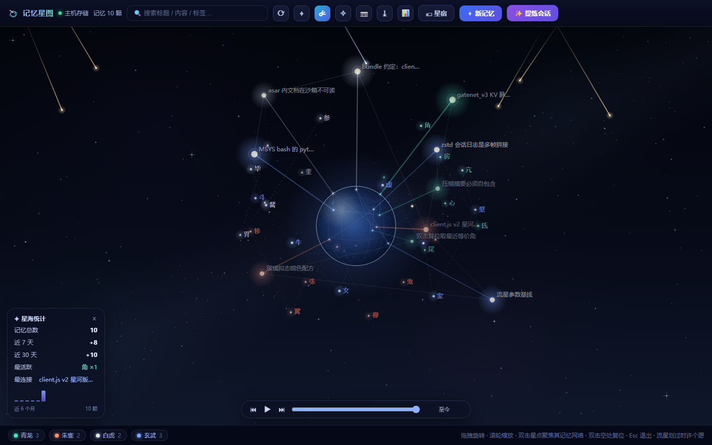
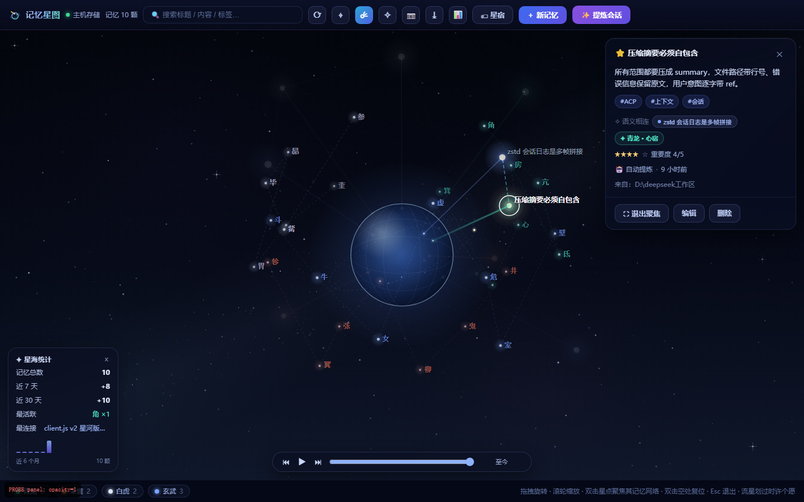
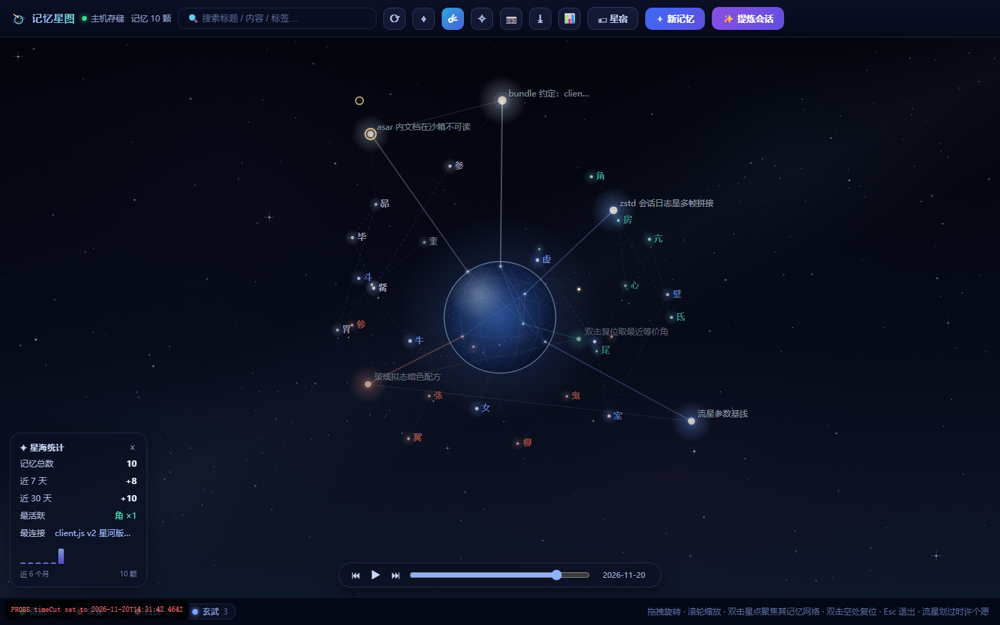
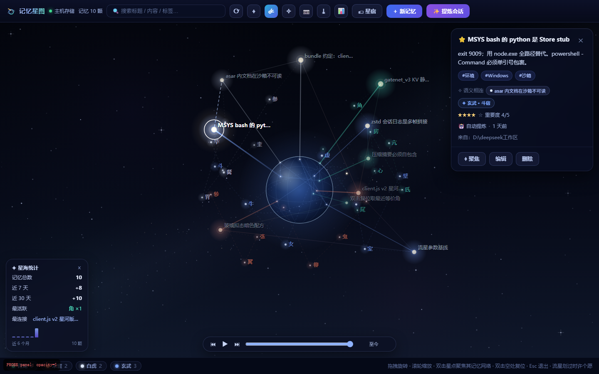

# Memory Star Map · 记忆星图

Renders the memories accumulated in your DSH sessions as an interactive **3D night sky** you can spin, zoom and light up.

- A glassy **Earth** at the center: terminator shading, lat/long grid and a fresnel rim;
- The **28 lunar mansions** as anchors on a celestial shell, colored by the four symbols
  (Azure Dragon / Vermilion Bird / White Tiger / Black Tortoise);
- **Every memory is a star**: a surface point lights up on the globe and radiates a new star
  into its mansion cluster; importance drives magnitude and glow;
- **Meteors** drift through deep space; new memories and accepted extraction candidates trigger
  targeted meteors and celebratory showers.

## Preview

| Double-click focus: camera fly-to + ego-network | Time travel: stars ignite along the timeline |
| --- | --- |
|  |  |

| Detail panel: semantic links / mansion / importance |  |
| --- | --- |
|  |  |

## Install (from GitHub)

1. Grab `dsh-memory-star-map-<version>.tgz` from [Releases](../../releases/latest);
2. DSH GUI → Plugins → install from file (or `plugin_manager install_bundle file:<tgz path>` in a session);
3. Or clone and pack it yourself: put the repository contents into a `package/` directory, then
   `tar -czf dsh-memory-star-map.tgz package` and install that tgz.

## Interaction

| Input | Effect |
| --- | --- |
| Drag / one-finger slide | Rotate (with inertia) |
| Wheel / pinch | Zoom |
| Double-click / ⌖ | Reset view |
| Click a star | Open detail panel (edit / delete) |
| ☄ button | Trigger a meteor shower |
| ⟳ button | Toggle idle auto-spin |
| Legend chips | Hide / show a whole symbol group |
| Search box | Matches pulse gold, the rest dim |

## Where memories come from

1. **Manual**: "＋ New memory" — title / content / tags / importance / mansion (auto-assigned when empty);
2. **Session extraction**: "✨ Extract" scans the last N sessions of a workspace
   (multi-frame `session.v4.jsonl.zstd` decoding), the current default model distills candidates
   into a pending area; only checked candidates are lit into the map.

Extraction filters user messages that look sensitive (password / token / secret / api-key patterns).

## The 28 mansions = skill categories

Each mansion stands for one skill category. Default names are the traditional lunar-mansion
names, but the toolbar "🏷 Mansions" panel renames them freely ("Photography", "Mathematics", …).
Every memory belongs to one category: extraction lets the model pick a category number from the
injected list, manual stars choose one in the form (round-robin when left empty). Memories of the
same category are chained in time order beneath their star; renaming a category migrates its
existing memories (swap-safe).

## Storage

- Preferred: host storage at `~/.dsh/storages/dsh-memory-star-map/stars.json` via `/api/memory-star-map`;
- Fallback: browser `localStorage`. The toolbar status dot shows the active mode
  (green = host, amber = local).

## Changelog

- **0.4.0 "Focus"**: community wishlist landed — double-click a star to focus it (camera fly-to +
  ego-network dimming), semantic constellation lines (auto links from shared tags, two-color
  gradient, flowing dash when hot), a time-travel scrubber with play mode that ignites stars along
  the timeline, search isolation mode, a glassy stats HUD (totals / last 7 & 30 days / top category /
  most-connected / 6-month sparkline), PNG & JSON export, serif mansion labels with zoom LOD,
  cascading Esc.
- **0.3.1**: client prefers v3 routes — mount probes every candidate base and pins the first host
  answering v3, skipping stale v2 zombie routes left by in-place upgrades (they would swallow
  mansion renames and classification).
- **0.3.0 "Constellations"**: the 28 mansions become renameable skill categories — "🏷 Mansions"
  panel (rename / restore defaults / per-category counts); extraction prompt injects the category
  list and the model classifies by number; candidates and the form show category chips; memories
  of one category are chained in time order; data model v3 (reads v2).

- **0.2.2**: in-place upgrades no longer require a DSH restart (host-side prefix-route fallback registration: a spare route is used when the primary is still held by a stale instance); label rects that would cover the globe disc are suppressed; visuals as in 0.2.0 "Galaxy".
- **0.2.0 "Galaxy"**: full visual & performance rewrite — glassmorphism UI, baked nebula/milky-way
  background, sinusoidal twinkle, parametric meteor showers, pre-baked glow sprites, ref-based
  animation state (zero per-frame setState), native non-passive wheel, unified pointer events
  (mouse + touch), pinch zoom, inertial camera, label collision avoidance, two-step delete,
  `prefers-reduced-motion` support, zh/en locale packs and detail-page docs.
- 0.1.0: first release (basic star map + session extraction).
