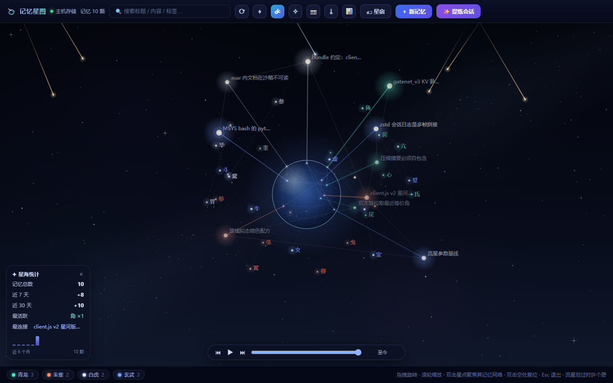
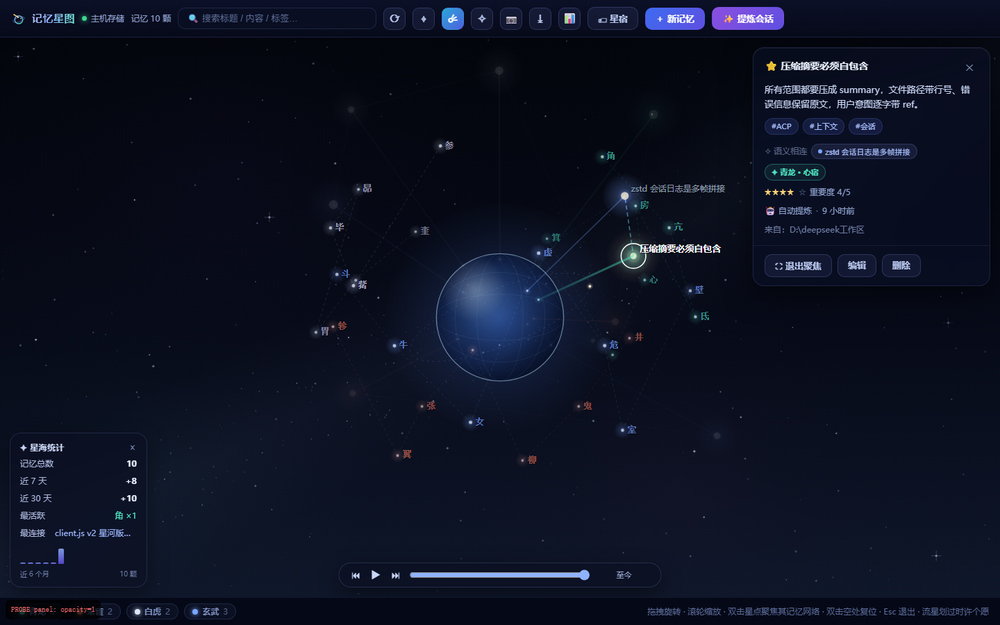
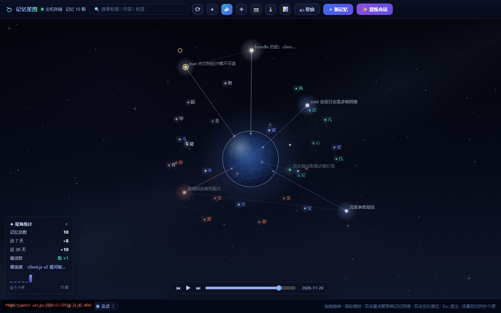
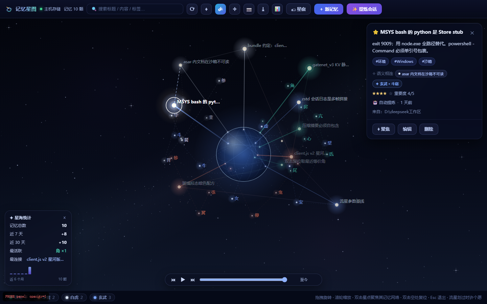

# 记忆星图 · Memory Star Map

把 DSH 会话里沉淀的记忆，渲染成一片可以旋转、缩放、点亮的**三维星空**。

- **地球**居中：玻璃质感的行星，带晨昏线、经纬网与菲涅尔边缘光；
- **二十八宿**为球壳锚点：青龙 / 朱雀 / 白虎 / 玄武四象配色，宿内记忆成簇排布；
- **每条记忆 = 一颗星**：地表点亮一个光点，向外放射一颗新星，重要度决定星等与光晕；
- **流星**划过深空：环境流星随机到访；新记忆诞生、提炼候选抵达时，会触发定向流星与流星雨庆祝。

## 效果预览

| 双击聚焦：相机飞行 + ego-network | 时间回放：星沿时间轴逐颗点亮 |
| --- | --- |
|  |  |

| 详情面板：语义相连 / 宿 / 重要度 |  |
| --- | --- |
|  |  |

## 安装（GitHub）

1. 从 [Releases](../../releases/latest) 下载 `dsh-memory-star-map-<版本>.tgz`；
2. DSH GUI → 插件 → 从文件安装（或会话内 `plugin_manager install_bundle file:<tgz 路径>`）；
3. 或克隆本仓库自行打包：将仓库内容放入 `package/` 目录后
   `tar -czf dsh-memory-star-map.tgz package`，再安装该 tgz。

## 交互

| 操作 | 效果 |
| --- | --- |
| 拖拽 / 单指滑动 | 旋转星空（带惯性） |
| 滚轮 / 双指捏合 | 缩放 |
| 双击 / ⌖ 按钮 | 复位视角 |
| 点击星点 | 打开记忆详情（编辑 / 删除） |
| ☄ 按钮 | 手动来一场流星雨 |
| ⟳ 按钮 | 开关空闲自转 |
| 图例四象 chip | 点击隐藏 / 显示该象全部星 |
| 搜索框 | 命中的星金色脉动，其余压暗 |

## 记忆从哪来

1. **手动种星**：工具栏「＋ 新记忆」，填标题 / 内容 / 标签 / 重要度 / 所属星宿（留空自动轮转分配）；
2. **会话提炼**：「✨ 提炼会话」扫描指定工作区最近 N 个会话（`session.v4.jsonl.zstd` 多帧解码），
   由当前默认模型归纳候选记忆，进入「待认领区」，勾选后「点亮入选」才正式入星图。

提炼时会过滤疑似敏感内容（密码 / token / secret / 密钥 / api key 等模式匹配的用户消息）。

## 二十八星宿 = 技艺大类

每个星宿代表一个技艺大类（默认沿用传统宿名，可在工具栏「🏷 星宿」面板改成
「摄影」「数学」等任意名字）。记忆入图时归入一个大类：提炼由模型按大类清单自动判定编号，
手动种星可在表单指定（留空轮转）。同一大类的记忆按时间链式连线，挂在该星之下；
改名时该类既有记忆会同步迁移（含两个类互换名字的情况）。

## 数据存储

- 优先宿主存储：`~/.dsh/storages/dsh-memory-star-map/stars.json`（经 `/api/memory-star-map` 读写）；
- 宿主不可用时自动回落到浏览器 `localStorage`，工具栏状态灯会显示当前存储模式
  （绿 = 主机存储，黄 = 本地存储）。

## 版本

- **0.4.0「聚焦」**：社区愿望单落地 —— 双击星点聚焦（相机飞行 + ego-network 压暗）、
  语义星座线（共享标签自动连线、两端宿色渐变、悬停流动虚线）、时间回放条（播放/ scrub，
  星沿时间轴逐颗点亮并触发诞生庆祝）、搜索隔离模式、星海统计 HUD（总数/近7天/近30天/
  最活跃/最连接/6 个月 sparkline）、PNG 与 JSON 导出、衬线宿名 + 缩放标签 LOD、Esc 级联退出。
- **0.3.1**：客户端 v3 路由优先选择 —— 启动探测全部候选 base，优先采用回 v3 的宿主实例，
  绕开原地升级残留的 v2 僵尸路由（僵尸路由会吞掉 mansions 改名与归类）。
- **0.3.0「列宿」**：二十八星宿升级为可改名的技艺大类 —— 「🏷 星宿」面板改名 / 恢复默认 / 各类计数；
  提炼 prompt 注入大类清单、模型按编号归类，候选与表单显示大类 chip；
  类内记忆按时间链式连线；数据模型 v3（兼容读 v2）。
- **0.2.2**：原地升级无需重启 DSH（宿主端 prefix 路由回退注册：主路由被旧实例占用时自动启用备用路由）；标签矩形压地球盘面抑制；视觉同 0.2.0「星河」。
- **0.2.0「星河」**：视觉与性能全面重写 —— 玻璃拟态 UI、烘焙星云银河背景、正弦闪烁星、
  参数化流星雨、预烘焙光晕 sprite、动画状态 ref 化（零每帧 setState）、原生 non-passive 滚轮、
  指针事件统一鼠标 / 触摸、双指捏合、惯性相机、标签碰撞避让、删除二次确认、
  `prefers-reduced-motion` 支持、中英语言包与详情页文档。
- 0.1.0：首版（基础星图 + 会话提炼）。
